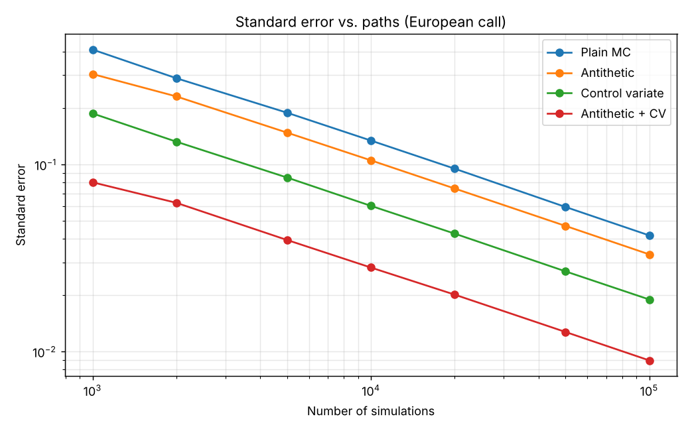
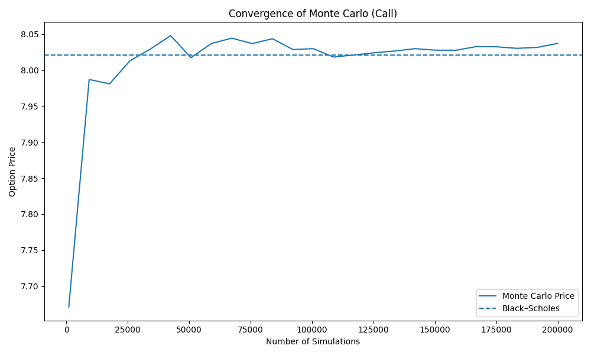

# Monte Carlo Option Pricing with Variance Reduction

[](https://github.com/wchetz13/monte-carlo-options-pricing/actions/workflows/ci.yml)

Monte Carlo pricer for European calls and puts under geometric Brownian motion, validated against the closed-form Black-Scholes price, with antithetic variates and a control variate.

## Model

Under the risk-neutral measure,

$$dS_t = r S_t\,dt + \sigma S_t\,dW_t, \qquad S_T = S_0\exp\!\big((r-\tfrac12\sigma^2)T + \sigma\sqrt{T}\,Z\big),$$

$$\text{Price} = e^{-rT}\,\mathbb{E}[\text{payoff}], \qquad \text{Call: } (S_T-K)^+, \quad \text{Put: } (K-S_T)^+ .$$

## Variance reduction

- **Antithetic variates.** Shocks $(Z,-Z)$ are simulated in pairs. The two members of a pair are negatively correlated, so the estimator averages each pair and the standard error is computed over the independent *pair means*. Treating all draws as i.i.d. would overstate the error.
- **Control variate.** $X=e^{-rT}S_T$ has known mean $\mathbb{E}[X]=S_0$. The estimator is $Y-\beta(X-S_0)$ with $\beta=\mathrm{Cov}(Y,X)/\mathrm{Var}(X)$ estimated from the sample.

## Results

Call, $S_0=100$, $K=105$, $T=1$, $r=5\%$, $\sigma=20\%$. Each scheme uses 10,000 simulations and is repeated 300 times with independent seeds (`python -m src.variance_study`). The empirical std is the true sampling error of the estimator; the reported SE is the average of the estimator's own error estimate.

| Scheme | Empirical std | Mean reported SE | Variance reduction |
|---|---|---|---|
| Plain MC | 0.13418 | 0.13186 | 1.0x |
| Antithetic | 0.10561 | 0.10471 | 1.6x |
| Control variate | 0.06122 | 0.05992 | 4.8x |
| Antithetic + CV | 0.02975 | 0.02848 | 20.3x |

The reported SE tracks the empirical std, which is checked by a test.



Validation against Black-Scholes (200,000 simulations, antithetic + control variate, `python -m src.monte_carlo`):

| Option | MC price | MC SE | BS price | Abs error |
|---|---|---|---|---|
| Call | 8.008442 | 0.006457 | 8.021352 | 0.012910 |
| Put | 7.887532 | 0.006457 | 7.900442 | 0.012910 |



## Asian options (path-dependent)

`src/asian.py` prices discretely monitored **arithmetic-average** Asian options, $\max(\pm(\bar S - K),0)$ with $\bar S=\frac1n\sum_i S_{t_i}$, which have no closed form. The control variate is the **geometric-average** Asian payoff, which is exactly priceable because the geometric mean of a lognormal path is lognormal:

$$\ln G\sim\mathcal N(m,v),\quad m=\ln S_0+(r-\tfrac12\sigma^2)T\tfrac{n+1}{2n},\quad v=\sigma^2T\tfrac{(n+1)(2n+1)}{6n^2}.$$

Arithmetic and geometric payoffs are almost perfectly correlated, so the control variate removes nearly all the variance. Call, $S_0=K=100$, $T=1$, $r=5\%$, $\sigma=20\%$, 50 fixings, 10,000 paths, 200 independent repetitions (`python -m src.asian_study`):

| Scheme | Mean price | Empirical std | Mean reported SE | Variance reduction |
|---|---|---|---|---|
| Plain MC | 5.8567 | 0.07880 | 0.08106 | 1.0x |
| Antithetic | 5.8571 | 0.05814 | 0.05622 | 1.8x |
| Geometric CV | 5.8576 | 0.00221 | 0.00224 | 1269x |
| Antithetic + geometric CV | 5.8576 | 0.00232 | 0.00234 | 1157x |

Once the control variate is on, antithetic sampling adds nothing here: the residual is already small and antithetic pairing mainly cancels its linear part. The reported SE tracks the empirical std in every row.

```python
from src.asian import asian_option_price, geometric_asian_price

price, se = asian_option_price(S0=100, K=100, T=1.0, r=0.05, sigma=0.2, n_steps=50, n_sims=100_000)
```

Tests (`tests/test_asian.py`) check the closed form against brute-force simulation, the one-fixing reduction to Black-Scholes, arithmetic ≥ geometric (AM-GM), Asian < vanilla, arithmetic put-call parity, and control-variate unbiasedness.

## Usage

```python
from src.monte_carlo import monte_carlo_option_price

price, se = monte_carlo_option_price(
    S0=100, K=105, T=1.0, r=0.05, sigma=0.2, n_sims=200_000, option_type="call"
)
```

## Tests

```bash
pip install -r requirements.txt pytest
pytest -q
```

The suite checks Black-Scholes reference values and put-call parity, that every scheme and option type lands within 4 standard errors of the analytic price, seed reproducibility, that variance reduction lowers the standard error, and that the reported SE matches the empirical spread. CI runs it on Python 3.11-3.13.
