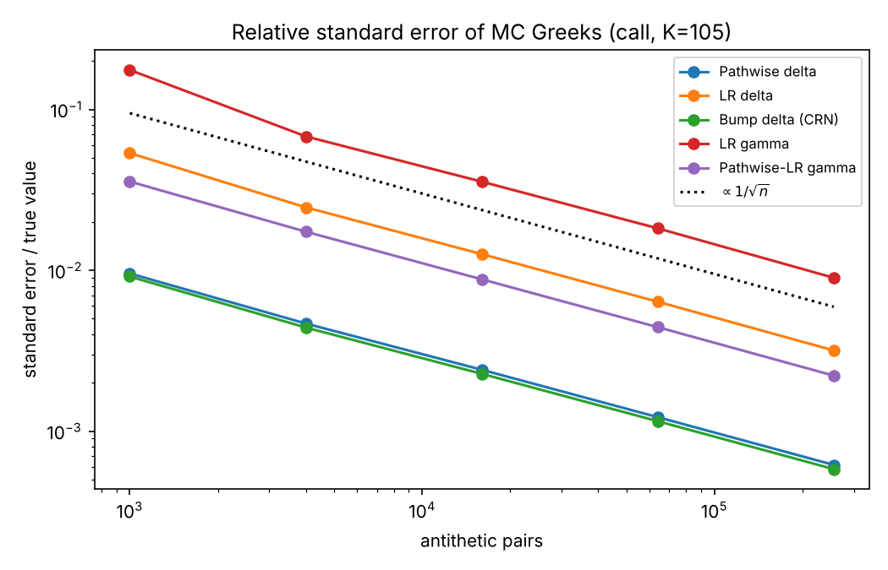

# Monte Carlo Greeks: pathwise, likelihood ratio, bump-and-revalue

`src/greeks_mc.py` estimates delta, gamma and vega of European options under GBM with three methods, all with antithetic shocks and standard errors, and `src/greeks_study.py` reproduces every number below (`python -m src.greeks_study`).

## Methods

Write the price as $V = e^{-rT}\,\mathbb{E}[f(S_T)]$ with $S_T = S_0 \exp\{(r-\tfrac12\sigma^2)T + \sigma\sqrt{T}Z\}$.

**Pathwise** differentiates the payoff along each path, using $\partial S_T/\partial S_0 = S_T/S_0$ and $\partial S_T/\partial\sigma = S_T(\sqrt{T}Z - \sigma T)$:

$$\Delta = e^{-rT}\,\mathbb{E}\!\left[\mathbf 1_{S_T>K}\,\tfrac{S_T}{S_0}\right],\qquad
\mathcal V = e^{-rT}\,\mathbb{E}\!\left[\mathbf 1_{S_T>K}\,S_T(\sqrt{T}Z-\sigma T)\right]\quad(\text{call}).$$

It needs a Lipschitz payoff, so it is unavailable for digitals and for gamma.

**Likelihood ratio** differentiates the lognormal density instead: $\partial_\theta V = e^{-rT}\mathbb{E}[f(S_T)\,\partial_\theta \log p]$, with scores

$$\frac{Z}{S_0\sigma\sqrt T}\ (\Delta),\qquad \frac{Z^2-1-\sigma\sqrt T Z}{S_0^2\sigma^2 T}\ (\Gamma),\qquad \frac{Z^2-1}{\sigma}-\sqrt T Z\ (\mathcal V).$$

It works for any payoff, but is noisier on smooth ones.

**Mixed pathwise-LR gamma** applies the score to the pathwise delta:
$\Gamma = e^{-rT}\mathbb{E}\big[\mathbf 1_{S_T>K}\tfrac{S_T}{S_0}\big(\tfrac{Z}{S_0\sigma\sqrt T}-\tfrac1{S_0}\big)\big]$.

**Bump-and-revalue** is a central difference. With common random numbers (CRN) the legs share shocks; with independent shocks the variance grows like $1/h^2$ (`common_random_numbers=False`).

## Results

Call, $S_0=100,\ K=105,\ T=1,\ r=5\%,\ \sigma=20\%$, 100,000 antithetic pairs (200,000 paths), seed 0. Spot bump 1.00, vol bump 0.01.

| Greek | Method | Estimate | Std. error | Black-Scholes |
|---|---|---:|---:|---:|
| delta | pathwise | 0.54283 | 0.00053 | 0.54223 |
| delta | likelihood ratio | 0.54269 | 0.00277 | 0.54223 |
| delta | bump (CRN) | 0.54250 | 0.00050 | 0.54223 |
| gamma | likelihood ratio | 0.02003 | 0.00029 | 0.01984 |
| gamma | pathwise-LR | 0.01984 | 0.00007 | 0.01984 |
| gamma | bump (CRN) | 0.01984 | 0.00025 | 0.01984 |
| vega | pathwise | 39.67480 | 0.14079 | 39.67052 |
| vega | likelihood ratio | 40.05724 | 0.57829 | 39.67052 |
| vega | bump (CRN) | 39.67518 | 0.14079 | 39.67052 |

For smooth payoffs pathwise and CRN bumping are the cheapest; the pure LR estimator has roughly 5x the standard error of pathwise on delta and vega. The mixed estimator cuts gamma standard error about 4x relative to pure LR (0.00007 vs 0.00029).

Cash-or-nothing digital delta (Black-Scholes 0.01889), 100,000 pairs, bump $h=1$:

| Method | Estimate | Std. error |
|---|---:|---:|
| likelihood ratio | 0.01889 | 0.00005 |
| bump (CRN) | 0.01893 | 0.00020 |
| bump (independent) | 0.01862 | 0.00028 |

All estimators converge at the $1/\sqrt n$ rate; the figure shows relative standard error against the number of antithetic pairs.

## Tests

`python -m pytest -q` (21 tests): closed-form Greeks vs finite differences of the Black-Scholes price; every estimator within 4 standard errors of the analytic value for call, put and digital; mixed gamma has lower variance than LR gamma; CRN reduces bump variance more than 5x; pathwise rejects digital payoffs and gamma.
